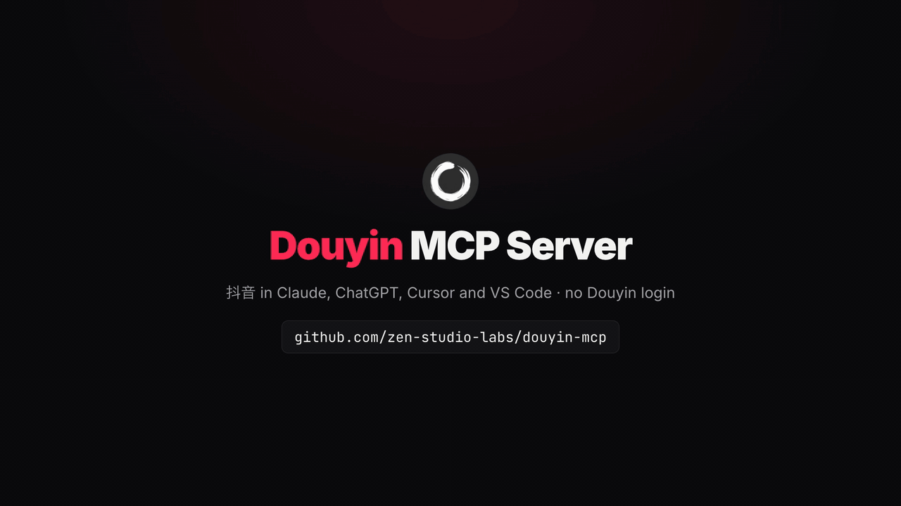
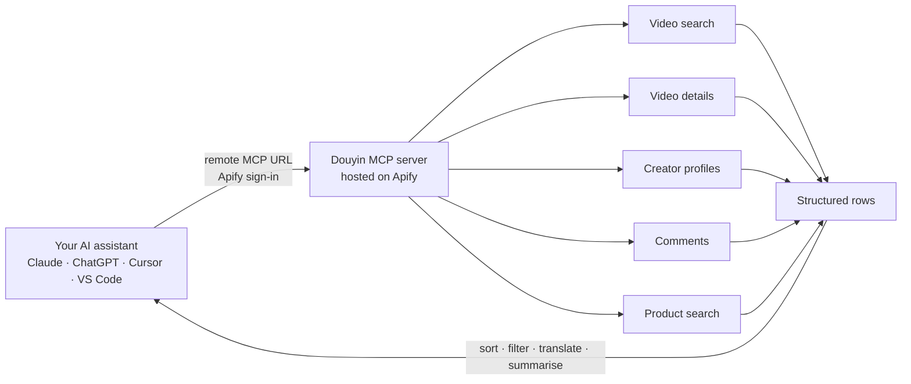

<div align="center">


# Douyin (抖音) MCP Server

**Douyin (抖音) data inside Claude, ChatGPT, Cursor and your own code: search videos, read comments, look up creators and find the products they sell. Hosted and read-only. No Douyin login, no cookies, nothing to install.**

**English** · [简体中文](README.zh-CN.md)

[](https://apify.com/zen-studio/douyin-search-scraper)
[](https://github.com/zen-studio-labs/douyin-mcp/actions/workflows/validate.yml)
[](LICENSE)



<sub>Built from a real search run on 2 November 2026.</sub>

[](https://cursor.com/en/install-mcp?name=douyin&config=eyJ1cmwiOiJodHRwczovL21jcC5hcGlmeS5jb20vP3Rvb2xzPWZldGNoLWFjdG9yLWRldGFpbHMsZ2V0LWFjdG9yLXJ1bixnZXQtZGF0YXNldC1pdGVtcyx6ZW4tc3R1ZGlvL2RvdXlpbi1zZWFyY2gtc2NyYXBlcix6ZW4tc3R1ZGlvL2RvdXlpbi12aWRlby1zY3JhcGVyLHplbi1zdHVkaW8vZG91eWluLXByb2ZpbGUtc2NyYXBlcix6ZW4tc3R1ZGlvL2RvdXlpbi1jb21tZW50cy1zY3JhcGVyLHplbi1zdHVkaW8vZG91eWluLXByb2R1Y3Qtc2VhcmNoLXNjcmFwZXIifQ==)
[](https://vscode.dev/redirect/mcp/install?name=douyin&config=%7B%22type%22%3A%22http%22%2C%22url%22%3A%22https%3A%2F%2Fmcp.apify.com%2F%3Ftools%3Dfetch-actor-details%2Cget-actor-run%2Cget-dataset-items%2Czen-studio%2Fdouyin-search-scraper%2Czen-studio%2Fdouyin-video-scraper%2Czen-studio%2Fdouyin-profile-scraper%2Czen-studio%2Fdouyin-comments-scraper%2Czen-studio%2Fdouyin-product-search-scraper%22%7D)
[](#client-setup)

[Quick start](#quick-start) · [Agent setup](#set-up-with-your-ai-agent) · [Tools](#tools) · [Prompts](#example-prompts) · [Client setup](#client-setup) · [API](#use-it-as-a-douyin-api) · [Pricing](#pricing) · [FAQ](#faq)

</div>

Douyin MCP is a hosted Douyin MCP server that connects your AI assistant to Douyin (抖音), the Chinese short-video app often called Chinese TikTok or TikTok China. Ask in English or Chinese: your assistant searches videos by keyword or hashtag, reads a video's full details and media links, pulls the comments under a video, looks up creators with their follower counts and recent posts, and searches Douyin Shop products with price, monthly sales and creator commission. Results come back as structured rows it can sort, filter, translate and summarise. Developers can call the same tools as a Douyin API.

## Why Douyin MCP

- **No Douyin account.** No QR-code login, no cookies, no Chinese phone number. Your own Douyin account is never used, so it is never at risk.
- **Nothing to install.** Add one URL and sign in with Apify. Works in claude.ai and ChatGPT too, not only in desktop apps.
- **Five tools in one server.** Video search, video details, creator profiles with their posts, comments, and Douyin Shop product search.
- **Rich, structured data.** Likes, comments, shares and saves per video, hashtags, music, upload city, creator followers, total likes and agency (MCN), and for products the price, monthly sales, shop score and creator commission rate.
- **Maintained for you.** Used by more than 15,000 people on the Apify Store. When Douyin changes, the tools are updated; your setup stays the same.
- **Made for assistants.** A bundled skill teaches your assistant the inputs that work and how to chain the tools, and long requests keep running while it checks back.
- **Pay per result.** Plus a small start fee per run, billed to your own Apify account. No subscription; try it on Apify's free plan.

| | Douyin MCP | Typical self-hosted Douyin tools |
|---|---|---|
| Douyin account, QR login or cookies | Not needed | Usually required, and cookies have to be renewed |
| Your own Douyin account | Never used | Sends every request |
| Setup | One URL and an Apify sign-in | Python or Docker, a local service, cookies copied from a browser |
| Web assistants (claude.ai, ChatGPT) | Supported | Usually desktop clients or local scripts only |
| When Douyin changes | Updated for you | Wait for a fix, or fix it yourself |
| Comments, creator profiles, shop products | All included | Varies; most focus on video downloads |
| Video files | A direct MP4 link per video; saving MP4 files is optional and billed per file | Usually the main feature |
| Cost | Pay per result | Free software, your own machine and time |

## How it works



Each tool call starts a run on your Apify account. Your assistant waits for it, reads the rows, and answers in plain language. Chain the tools for deeper answers: search a topic, open the top videos, read their comments, then look up the creators behind them.

## Quick start

1. **Create a free [Apify account](https://console.apify.com/sign-up)** if you do not have one.
2. **Add the server to your assistant.** Click a button above, or follow the steps for your client below.
3. **Sign in with Apify when your assistant asks**, then ask a question such as *"Find the 10 most-liked Douyin videos about camping (露营) from the past week and list the creators, likes and saves."*

**About the Apify sign-in page.** Apify notes that your assistant "was registered dynamically and wasn't verified by Apify" and asks for full API access. Every assistant that signs in this way sees that notice; it lets your assistant start runs on your account. You can remove the access at any time on your [Apify Console integrations page](https://console.apify.com/settings/integrations).

Server URL, for any client that accepts a remote MCP server:

```text
https://mcp.apify.com/?tools=fetch-actor-details,get-actor-run,get-dataset-items,zen-studio/douyin-search-scraper,zen-studio/douyin-video-scraper,zen-studio/douyin-profile-scraper,zen-studio/douyin-comments-scraper,zen-studio/douyin-product-search-scraper
```

## Set up with your AI agent

Paste this repository's URL into Claude Code, Codex, Cursor or another agent and ask it to set up Douyin MCP. The steps below are written so your agent can follow them.

**For AI agents installing this server:**

1. This is a hosted remote MCP server (streamable HTTP). There is nothing to download or build. It needs a free Apify account and an Apify sign-in (OAuth) in the user's browser; do not ask for an API token unless the sign-in fails.
2. Server name `douyin`, server URL:
   ```text
   https://mcp.apify.com/?tools=fetch-actor-details,get-actor-run,get-dataset-items,zen-studio/douyin-search-scraper,zen-studio/douyin-video-scraper,zen-studio/douyin-profile-scraper,zen-studio/douyin-comments-scraper,zen-studio/douyin-product-search-scraper
   ```
3. Add it with the client's own command:
   - Claude Code: `claude plugin marketplace add zen-studio-labs/douyin-mcp`, then `claude plugin install douyin@douyin-mcp` (adds the server and the Douyin skill).
   - Codex: `codex mcp add douyin --url "<server URL>"`, then `codex mcp login douyin`.
   - VS Code: `code --add-mcp '{"name":"douyin","type":"http","url":"<server URL>"}'`.
   - Cursor and other clients: add `{"mcpServers": {"douyin": {"url": "<server URL>"}}}` to the client's MCP config file (Cursor: `~/.cursor/mcp.json`).
4. Ask the user to complete the sign-in. In Claude Code they run `/mcp`, select douyin and choose **Authenticate**; other clients open the Apify sign-in page themselves. A client restart may be needed before the tools appear.
5. Check it works with one small Video details request, for example `videoUrls: ["7702714233150131482"]`. Each video is billed to the user's Apify account. Do not test with search: Apify's free plan allows only two search runs in total.
6. Before real requests, read the [Douyin skill](skills/douyin/SKILL.md): it explains how long runs work, how the tools chain together and which inputs return good results.

## Tools

| Tool | What you get | Store page |
|---|---|---|
| Video search | Videos for any keyword or hashtag with caption, likes, comments, shares, saves, creator, hashtags, music and video links. Sort by relevance, most liked or newest; filter by publish time and video length. Up to 2,000 videos per keyword and 50 keywords per run. | [douyin-search-scraper](https://apify.com/zen-studio/douyin-search-scraper) |
| Video details | Full details from a video link, share link or ID: caption, engagement, creator, hashtags, music, upload city, cover, and direct video and audio links. Optionally saves MP4 files, covers and photo-post images. | [douyin-video-scraper](https://apify.com/zen-studio/douyin-video-scraper) |
| Creator profile | Bio, followers, total likes, post count, verification, agency (MCN), shop flag and region, plus the creator's recent posts with engagement. Filter posts by recent days, or look up profiles only. Up to 25 creators per run. | [douyin-profile-scraper](https://apify.com/zen-studio/douyin-profile-scraper) |
| Comments | Top-level comments under a video with likes, reply count, date, region and commenter, plus replies on paid Apify plans. Up to 5,000 comments per video. | [douyin-comments-scraper](https://apify.com/zen-studio/douyin-comments-scraper) |
| Product search | Douyin Shop products for a keyword: price, monthly sales and a 30-day sales trend, rating, category, shop and shop score, creator commission rate and how many creators promote it. Optional detail images and lifetime sales. Up to about 500 products per keyword. | [douyin-product-search-scraper](https://apify.com/zen-studio/douyin-product-search-scraper) |

All tools are read-only. They never post, like, comment, follow, send messages or buy.

<details>
<summary><b>Key fields per tool</b></summary>

| Tool | Key fields |
|---|---|
| Video search | `id`, `url`, `text` (caption), `createDate`, `statistics.diggCount` (likes), `statistics.commentCount`, `statistics.shareCount`, `statistics.collectCount` (saves), `authorMeta.name`, `authorMeta.secUid`, `authorMeta.followersCount`, `hashtags`, `videoMeta.duration` (milliseconds), `city`, `searchPosition` |
| Video details | `id`, `url`, `text`, `createDate`, `statistics` (likes, comments, shares, saves), `authorMeta`, `hashtags`, `region`, `city`, `videoUrl`, `audioUrl`, `coverUrl`, `durationSeconds`, `videoMeta.cdnUrlExpiresAt` (when the video link stops working), `musicMeta`, `videoTags`, `images` (slideshows), and saved files in `videoFile`, `coverFile`, `slideshowFiles`. No `searchPosition` |
| Creator profile | Two shapes. By default, one row per post: `id`, `url`, `text`, `createDate`, `isPinned`, `statistics`, `hashtags`, `videoMeta`, `musicMeta`, `images`, `region`, `city`, with the creator in `authorMeta`; no flat `videoUrl`/`coverUrl` and no saved files. With `maxPostsPerProfile: 0`, one row per creator with the profile at the top level: `name`, `secUid`, `signature` (bio), `followersCount`, `totalLikesReceived`, `awemeCount` (posts), `verified`, `customVerifyText`, `mcnInfo`, `withShopEntry`, `ipLocation`, `profileUrl`. |
| Comments | `text`, `createDate`, `likeCount`, `replyCount`, `region`, `isAuthorLiked`, `user.nickname`, `user.secUid`, `replies[]`, `awemeUrl` |
| Product search | `title`, `detailUrl`, `price.amount`, `sales.monthlySold`, `sales.goodReviewRatio`, `sales.salesTrend`, `category`, `shop.shopName`, `shop.shopScore`, `affiliate.commissionRatePercent`, `affiliate.cooperatingCreators`, `tags`; with `includeDetails`, also `gallery`, `serviceGuarantees`, `sales.lifetimeSold` |

Each Store page lists every field.

</details>

## Example prompts

**Brand and marketing research**
- *What are Douyin users saying about Luckin Coffee's new drinks? Read the top 100 comments on the three most-liked videos from the past week and group them into praise and complaints.*
- *Compare how Douyin videos talk about Dyson and Laifen hair dryers: price, noise, results.*

**Trends and content ideas**
- *Find the newest Douyin videos about 露营 from the past day and list the hashtags that keep coming up.*
- *What kinds of 穿搭 videos got the most saves this week? Summarise the formats and video lengths that work.*

**Creators (KOL)**
- *Look up this creator and rank their last 20 posts by likes: https://www.douyin.com/user/MS4wLjABAAAA9CpHmhKxCNlmd3Hig_KcgRgBKplditZhV47xCpDWFEM*
- *Find Douyin creators who post about 成都美食 and compare their follower counts, total likes and agency.*

**Comments and sentiment**
- *Read the comments on this video, most liked first, and group them by sentiment: https://www.douyin.com/video/7702714233150131482*
- *Which regions do the commenters on this video come from? Show a count per region.*

**Douyin Shop and live-commerce products**
- *Find Douyin Shop products for 蓝牙耳机 under ¥100 and rank them by monthly sales, with shop score and commission rate.*
- *Which 露营装备 products are promoted by the most creators? Show price, monthly sales and the 30-day trend.*

**In Chinese**
- *搜索抖音上最近一周点赞最多的露营视频，列出博主、点赞数和收藏数。*
- *查一下抖音商城里月销量最高的口红，对比价格、店铺评分和佣金比例。*

Tip: for Chinese topics, search in Chinese (`露营`, `穿搭`, `口红`); that is how people caption their videos and name their products. Brand names and hashtags work as they are.

## Client setup

<details open>
<summary><b>Claude (claude.ai and Claude Desktop)</b></summary>

1. Open **Settings** > **Connectors** and select **Add custom connector**.
2. Name it `Douyin` and paste the server URL above.
3. Select **Connect** and sign in with Apify.
4. In a chat, enable the Douyin connector from the tools menu.

The connector syncs between claude.ai and Claude Desktop. Custom connector availability depends on your Claude plan. For better results, also add the [Douyin skill](skills/douyin/SKILL.md): download [douyin-skill.zip](https://github.com/zen-studio-labs/douyin-mcp/releases/latest/download/douyin-skill.zip) and upload it under **Skills** in Claude's settings.

</details>

<details>
<summary><b>Claude Code</b></summary>

Plugin (server plus the Douyin skill, recommended):

```text
/plugin marketplace add zen-studio-labs/douyin-mcp
/plugin install douyin@douyin-mcp
```

Server only:

```bash
claude mcp add --transport http douyin "https://mcp.apify.com/?tools=fetch-actor-details,get-actor-run,get-dataset-items,zen-studio/douyin-search-scraper,zen-studio/douyin-video-scraper,zen-studio/douyin-profile-scraper,zen-studio/douyin-comments-scraper,zen-studio/douyin-product-search-scraper"
```

Then sign in: run `/mcp`, select the douyin server and choose **Authenticate**. Until you do, `/mcp` lists the server as not authenticated and may say its tools could not be fetched; both clear once you sign in.

</details>

<details>
<summary><b>Cursor</b></summary>

Click **Install in Cursor** above, or add [`examples/cursor-mcp.json`](examples/cursor-mcp.json) to `~/.cursor/mcp.json` (all projects) or `.cursor/mcp.json` (one project). Cursor asks you to sign in with Apify on first use.

</details>

<details>
<summary><b>VS Code and GitHub Copilot</b></summary>

Click **Install in VS Code** above ([VS Code Insiders](https://insiders.vscode.dev/redirect/mcp/install?name=douyin&config=%7B%22type%22%3A%22http%22%2C%22url%22%3A%22https%3A%2F%2Fmcp.apify.com%2F%3Ftools%3Dfetch-actor-details%2Cget-actor-run%2Cget-dataset-items%2Czen-studio%2Fdouyin-search-scraper%2Czen-studio%2Fdouyin-video-scraper%2Czen-studio%2Fdouyin-profile-scraper%2Czen-studio%2Fdouyin-comments-scraper%2Czen-studio%2Fdouyin-product-search-scraper%22%7D&quality=insiders)), or add [`examples/vscode-mcp.json`](examples/vscode-mcp.json) to `.vscode/mcp.json`. Start the server from the MCP view and sign in with Apify when prompted. Use the tools in Copilot Chat agent mode.

</details>

<details>
<summary><b>ChatGPT</b></summary>

1. Open [ChatGPT Plugins](https://chatgpt.com/plugins), select **+**, then **Add custom MCP server**.
2. Name it `Douyin`, paste the server URL above, and choose **OAuth** authentication.
3. Confirm, create the plugin, and sign in with Apify.
4. In a new chat, type `@` and select **Douyin**.

Business, Enterprise and Edu workspaces may need an admin to enable custom servers. See OpenAI's [custom MCP server guide](https://help.openai.com/en/articles/12584461-connecting-custom-mcp-servers-in-chatgpt).

</details>

<details>
<summary><b>Codex</b></summary>

```bash
codex mcp add douyin --url "https://mcp.apify.com/?tools=fetch-actor-details,get-actor-run,get-dataset-items,zen-studio/douyin-search-scraper,zen-studio/douyin-video-scraper,zen-studio/douyin-profile-scraper,zen-studio/douyin-comments-scraper,zen-studio/douyin-product-search-scraper"
codex mcp login douyin
```

Or copy [`examples/codex-config.toml`](examples/codex-config.toml) into `~/.codex/config.toml`.

</details>

<details>
<summary><b>Other clients, or a token instead of sign-in</b></summary>

Most clients that support remote MCP servers accept:

```json
{
  "mcpServers": {
    "douyin": {
      "url": "https://mcp.apify.com/?tools=fetch-actor-details,get-actor-run,get-dataset-items,zen-studio/douyin-search-scraper,zen-studio/douyin-video-scraper,zen-studio/douyin-profile-scraper,zen-studio/douyin-comments-scraper,zen-studio/douyin-product-search-scraper"
    }
  }
}
```

If your client cannot complete the Apify sign-in, send your Apify token as a header instead, see [`examples/bearer-token-mcp.json`](examples/bearer-token-mcp.json). Copy the token from your [Apify Console integrations page](https://console.apify.com/settings/integrations) and keep it out of shared files. Clients that only run local servers can bridge with `mcp-remote`, see [`examples/claude-desktop-config.json`](examples/claude-desktop-config.json).

</details>

## Use it as a Douyin API

Each tool is also an [Apify Actor](https://apify.com/zen-studio) with a REST API, so you can call it from your own code, a pipeline or an automation, without an assistant. Copy your API token from the [Apify Console integrations page](https://console.apify.com/settings/integrations). The input fields are the same ones the assistant uses; each Store page has an **API** tab with ready-made code and the full input reference.

<details open>
<summary><b>Python</b></summary>

```bash
pip install apify-client
```

```python
import os
from apify_client import ApifyClient

client = ApifyClient(os.environ["APIFY_TOKEN"])
run = client.actor("zen-studio/douyin-search-scraper").call(
    run_input={"keywords": ["露营"], "maxResultsPerQuery": 20, "sort": "most_liked", "publishTime": "one_week"}
)
for item in client.dataset(run["defaultDatasetId"]).iterate_items():
    print(item["statistics"]["diggCount"], item["text"][:40], item["url"])
```

</details>

<details>
<summary><b>JavaScript and TypeScript</b></summary>

```bash
npm install apify-client
```

```js
import { ApifyClient } from 'apify-client';

const client = new ApifyClient({ token: process.env.APIFY_TOKEN });
const run = await client.actor('zen-studio/douyin-search-scraper').call({
    keywords: ['露营'],
    maxResultsPerQuery: 20,
    sort: 'most_liked',
    publishTime: 'one_week',
});
const { items } = await client.dataset(run.defaultDatasetId).listItems();
console.log(items);
```

</details>

<details>
<summary><b>HTTP</b></summary>

Start a run and get its results in one request:

```bash
curl -X POST "https://api.apify.com/v2/acts/zen-studio~douyin-search-scraper/run-sync-get-dataset-items" \
  -H "Authorization: Bearer $APIFY_TOKEN" \
  -H "Content-Type: application/json" \
  -d '{"keywords": ["露营"], "maxResultsPerQuery": 20, "sort": "most_liked"}'
```

This waits up to 300 seconds. For bigger runs, start the run asynchronously and read its dataset when it finishes, see the [Apify API reference](https://docs.apify.com/api/v2/act-run-sync-get-dataset-items-post).

</details>

<details>
<summary><b>n8n, Make and Zapier</b></summary>

Use Apify's official integration for [n8n](https://docs.apify.com/platform/integrations/n8n), [Make](https://docs.apify.com/platform/integrations/make) or [Zapier](https://docs.apify.com/platform/integrations/zapier), choose the Actor (for example `zen-studio/douyin-search-scraper`) and pass the same JSON input.

</details>

Other tools: replace the Actor ID with `zen-studio/douyin-video-scraper`, `zen-studio/douyin-profile-scraper`, `zen-studio/douyin-comments-scraper` or `zen-studio/douyin-product-search-scraper`.

## Use cases

- **Brand and marketing research.** How Chinese viewers talk about a brand, a product or a campaign, straight from videos and comments.
- **Trend monitoring.** The newest or most-liked videos on a topic this week, by keyword or hashtag.
- **Creator research (KOL).** Find creators in a niche, then compare followers, total likes, posting rhythm and agency ties.
- **Social listening.** Comment threads with likes and commenter regions, ready for sentiment analysis.
- **Live-commerce and product research.** What sells on Douyin Shop: prices, monthly sales, sales trends, shop scores and how many creators promote each product.
- **Cross-border selling.** Check demand and price points in China before you stock or list a product.

## Example output

One search row from the run on 2 November 2026, abridged. Your assistant reads rows like this and answers in plain language.

```json
{
  "id": "7702714233150131482",
  "url": "https://www.douyin.com/video/7702714233150131482",
  "text": "沉浸式露营|听雨、独处、吃饭。好爱这种氛围感，远离城市，找回自己～#露营是成年人的过家家 #户外 #露营 ...",
  "createDate": "2026-10-31",
  "statistics": {
    "diggCount": 51239,
    "commentCount": 253,
    "shareCount": 1912,
    "collectCount": 507
  },
  "authorMeta": {
    "name": "梓依（旅行版）",
    "followersCount": 2039188,
    "secUid": "MS4wLjABAAAA9CpHmhKxCNlmd3Hig_KcgRgBKplditZhV47xCpDWFEM"
  },
  "hashtags": [{ "name": "露营是成年人的过家家" }, { "name": "户外" }, { "name": "露营" }],
  "videoMeta": { "duration": 187009 },
  "city": "Xi'an",
  "searchPosition": 1
}
```

## How long requests work

Each tool call returns within about 45 seconds. Bigger requests keep running on Apify after that, and your assistant checks back until the results are ready, then reads them in pages. You may see a few "still running" updates; that is expected. The [Douyin skill](skills/douyin/SKILL.md) teaches assistants this flow, along with input recipes for each tool. Claude Code gets it with the plugin.

## Pricing

Pay per result plus a small start fee per run, billed to your Apify account. There is no subscription to this repository. Current prices, including volume discounts, are on each tool's pricing page:

- [Video search](https://apify.com/zen-studio/douyin-search-scraper/pricing)
- [Video details](https://apify.com/zen-studio/douyin-video-scraper/pricing)
- [Creator profile](https://apify.com/zen-studio/douyin-profile-scraper/pricing)
- [Comments](https://apify.com/zen-studio/douyin-comments-scraper/pricing)
- [Product search](https://apify.com/zen-studio/douyin-product-search-scraper/pricing)

Your assistant controls cost through result caps such as `maxResultsPerQuery` and `maxCommentsPerAweme`. Ask for a small number first, then scale up. Saving MP4 files and product details are billed separately, per file and per product.

**Free Apify plan:** a few previews per tool with small caps. Video search: 2 runs in total, 10 videos from the first keyword. Video details: 10 videos in total. Creator profile: 5 runs, the first creator with up to 20 posts. Comments: 15 runs, one video with about 20 top-level comments and no replies. Product search: 5 runs, up to 20 products from the first keyword, without product details. At busy times the free preview can be unavailable for a short while. Any paid Apify plan removes these caps.

## Limitations

- **No trending list (热榜) or home feed.** Use video search sorted by most liked or newest instead.
- **No creator search by name.** Display names and the 抖音号 on a profile are not accepted. Use a profile link, a share link, or the `authorMeta.secUid` from a search row.
- **Comments need a full video link or ID.** Short `v.douyin.com` share links work in Video details and Creator profile, not in Comments.
- **Play counts are usually not available.** Likes, comments, shares and saves are.
- **Media links expire.** Direct video links last about an hour and cover images two weeks or more; the video `url` is the lasting reference. Save MP4 files if you need to keep them.
- **Read-only, Douyin only.** No posting, likes, comments, messages or purchases, and no TikTok content.

Use the data responsibly and in line with Douyin's terms and the data protection laws that apply to you, such as PIPL and GDPR.

## Troubleshooting

- **`/mcp` says the server is not authenticated, or its tools could not be fetched.** Select the server and choose **Authenticate**. Other clients show a **Connect** or **Sign in** button.
- **A search returns few videos.** Narrow keywords run out sooner. Try related keywords, a Chinese term, or remove the time filter.
- **A creator cannot be found.** The 抖音号 shown on a profile is not accepted. Use the profile link, a share link from the app, or `authorMeta.secUid` from a search row.
- **Comments reject a link.** Pass the full `douyin.com/video/...` link or the numeric video ID, not a short share link.
- **A search stopped at 10 videos, or no free runs are left.** That is the free Apify plan. Any paid plan removes it.
- **A run says the free preview is temporarily unavailable or at capacity.** Try again a little later, or use a paid Apify plan.
- **Your assistant says a run is still going.** That is normal for bigger requests. Ask it to keep checking the same run; a new request for the same question is billed again.
- **A video link stopped working.** Direct video links expire after about an hour. Fetch the video again with Video details, or save the MP4 file.
- **Your client cannot complete the sign-in.** Use an Apify token header instead, see [Other clients](#client-setup).

## FAQ

**What is Douyin?**
Douyin (抖音) is ByteDance's short-video app for mainland China, where creators post short videos, photo posts and live streams, and many sell products through Douyin Shop. TikTok is its international counterpart; the two are separate apps with separate accounts and content.

**Is this TikTok?**
No. This server covers Douyin only. "TikTok China" and "Chinese TikTok" are informal names for Douyin.

**Is there a Douyin API?**
Yes. Every tool can be called over a REST API or with Apify's Python and JavaScript clients, see [Use it as a Douyin API](#use-it-as-a-douyin-api).

**How is this different from open-source Douyin MCP servers and download tools?**
Open-source tools run on your machine, usually need cookies from your own logged-in Douyin account, and stop working until someone updates them when Douyin changes. Douyin MCP is hosted and read-only: no Douyin account, nothing to run, and it works in web assistants such as claude.ai and ChatGPT. It also covers comments, creator profiles and shop products, not only video files.

**Do I need a Douyin account or a Chinese phone number?**
No. You only need an Apify account, which takes a minute to create.

**Can it post, like, comment or buy?**
No. All tools are read-only by design.

**Can I download Douyin videos?**
Yes. Video details returns a direct MP4 link for video posts that works for about an hour, and Video search and Video details can save MP4 files, covers and photo-post images to your Apify storage. Saved MP4 files are billed per file.

**Is the data live?**
Yes. Results reflect Douyin at the moment you ask.

**Can I use it outside China?**
Yes, from any country. Most captions and comments are in Chinese; ask your assistant to translate them.

**Which AI assistants work with it?**
Any client that supports remote MCP servers, including Claude (claude.ai, Claude Desktop, Claude Code), ChatGPT, Codex, Cursor, VS Code with GitHub Copilot and many more.

**Is it free?**
You can try it on Apify's free plan, with a few previews per tool. After that you pay per result; see [Pricing](#pricing).

**Is this an official Douyin product?**
No. Douyin MCP is an independent product by Zen Studio and is not affiliated with Douyin, ByteDance or TikTok.

## Privacy

Requests go to Apify's hosted MCP server and run on your Apify account. Apify's [privacy policy](https://docs.apify.com/legal/privacy-policy) applies. This repository contains configuration and instructions only; it collects nothing.

## More from Zen Studio

Douyin MCP is built on [Zen Studio's Apify Actors](https://apify.com/zen-studio). You can also run each tool directly on Apify, from its API, or on a schedule. For Xiaohongshu (小红书) notes, comments and creators, see [RedNote MCP](https://github.com/zen-studio-labs/rednote-xiaohongshu-mcp). For Xianyu (闲鱼) second-hand listings, see [Goofish MCP](https://github.com/zen-studio-labs/goofish-mcp).

## License

[MIT](LICENSE). Douyin, 抖音 and TikTok are trademarks of their respective owners.
