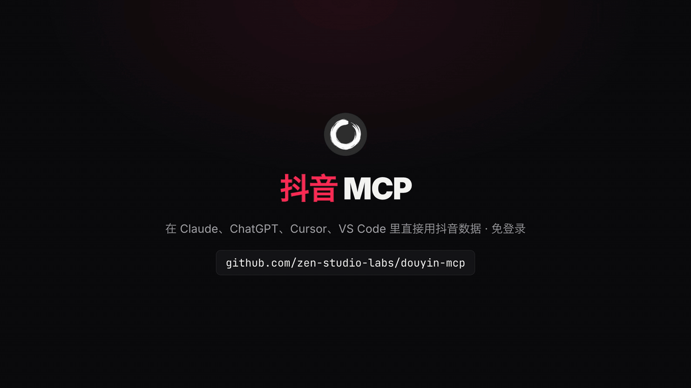
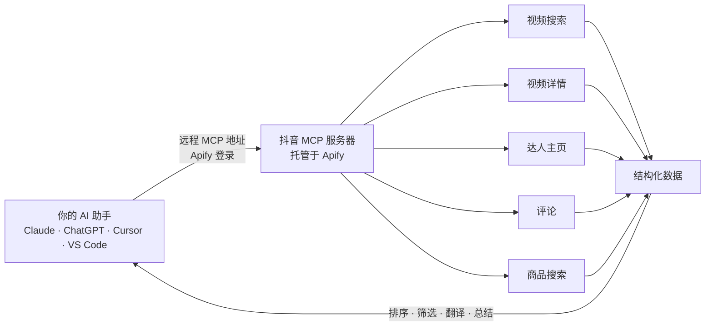

<div align="center">


# 抖音 MCP（Douyin MCP Server）

**让 Claude、ChatGPT、Cursor 等 AI 助手直接搜索抖音视频、读取评论区、查看达人主页、搜索抖音商城商品。云端托管，免登录，不用 Cookie，不用部署，也可通过 API 调用。**

[English](README.md) · **简体中文**

[](https://apify.com/zen-studio/douyin-search-scraper)
[](https://github.com/zen-studio-labs/douyin-mcp/actions/workflows/validate.yml)
[](LICENSE)



<sub>画面数据来自 2026 年 11 月 2 日的一次真实搜索。</sub>

[](https://cursor.com/en/install-mcp?name=douyin&config=eyJ1cmwiOiJodHRwczovL21jcC5hcGlmeS5jb20vP3Rvb2xzPWZldGNoLWFjdG9yLWRldGFpbHMsZ2V0LWFjdG9yLXJ1bixnZXQtZGF0YXNldC1pdGVtcyx6ZW4tc3R1ZGlvL2RvdXlpbi1zZWFyY2gtc2NyYXBlcix6ZW4tc3R1ZGlvL2RvdXlpbi12aWRlby1zY3JhcGVyLHplbi1zdHVkaW8vZG91eWluLXByb2ZpbGUtc2NyYXBlcix6ZW4tc3R1ZGlvL2RvdXlpbi1jb21tZW50cy1zY3JhcGVyLHplbi1zdHVkaW8vZG91eWluLXByb2R1Y3Qtc2VhcmNoLXNjcmFwZXIifQ==)
[](https://vscode.dev/redirect/mcp/install?name=douyin&config=%7B%22type%22%3A%22http%22%2C%22url%22%3A%22https%3A%2F%2Fmcp.apify.com%2F%3Ftools%3Dfetch-actor-details%2Cget-actor-run%2Cget-dataset-items%2Czen-studio%2Fdouyin-search-scraper%2Czen-studio%2Fdouyin-video-scraper%2Czen-studio%2Fdouyin-profile-scraper%2Czen-studio%2Fdouyin-comments-scraper%2Czen-studio%2Fdouyin-product-search-scraper%22%7D)
[](#客户端配置)

[快速开始](#快速开始) · [让 AI 帮你安装](#让-ai-助手帮你安装) · [工具](#工具) · [提问示例](#提问示例) · [客户端配置](#客户端配置) · [API](#抖音-api代码调用) · [价格](#价格) · [常见问题](#常见问题)

</div>

抖音 MCP 让你的 AI 助手直接读取抖音（Douyin）数据。用中文或英文提问都行：按关键词或话题搜索视频，查看单条视频的完整数据和视频链接，拉取评论区，查看达人的粉丝数、获赞数和近期作品，还能搜索抖音商城的带货商品，看价格、月销量和佣金。结果是结构化数据，AI 助手可以直接排序、筛选、翻译和总结；开发者也可以把它当作抖音 API 在代码里调用。

## 为什么选择抖音 MCP

- **免登录，不怕封号。** 不用扫码，不用导出 Cookie，也不用中国手机号。全程不使用你的抖音账号，账号不会因此受影响。
- **无需部署。** 云端托管的远程 MCP 服务：填入一个地址，登录 Apify 即可使用。不用 Docker，不用本地服务，也不用装 Python 环境；网页版 claude.ai 和 ChatGPT 也能用。
- **一个服务器，五个工具。** 视频搜索、视频详情、达人主页（含作品）、评论、抖音商城商品搜索。
- **数据丰富且结构化。** 每条视频的点赞、评论、分享、收藏数，话题标签，背景音乐，发布城市；达人的粉丝数、总获赞和 MCN 机构；商品的到手价、月销量、店铺体验分和带货佣金比例。
- **持续维护。** Apify Store 上已有超过 15,000 名用户。抖音改版时我们负责适配，你的配置不用改。
- **为 AI 助手优化。** 自带 Skill，告诉 AI 助手怎么传参、怎么组合调用各个工具；耗时较长的任务在后台继续跑，AI 助手会自动轮询进度。
- **按量付费。** 按返回结果计费（另有少量单次启动费），从你自己的 Apify 账号扣费，无需订阅，可用 Apify 免费套餐试用。

| | 抖音 MCP | 开源自部署方案 |
|---|---|---|
| 抖音账号、扫码登录或 Cookie | 不需要 | 通常需要，Cookie 过期还得重新导出 |
| 你自己的抖音账号 | 从不使用 | 每个请求都用你的账号发出 |
| 安装配置 | 一个地址加一次 Apify 登录 | Python 或 Docker，本地服务，从浏览器复制 Cookie |
| 网页版 AI 助手（claude.ai、ChatGPT） | 支持 | 通常只支持桌面客户端或本地脚本 |
| 抖音改版后 | 我们负责适配 | 等作者修复，或自己修 |
| 评论、达人主页、商城商品 | 全部包含 | 不一定，多数只做视频下载 |
| 视频文件 | 每条视频都有 MP4 直链；可选保存 MP4，按文件计费 | 通常是主要功能 |
| 成本 | 按结果计费 | 软件免费，但要自己维护环境、花时间折腾 |

## 工作原理



每次调用工具，都会在你的 Apify 账号下创建一个运行任务（Run）。AI 助手等任务完成后读取数据，再用自然语言回答你。多个工具可以组合使用：先搜索话题，再打开爆款视频、读取评论区，最后查看发布这些视频的达人。

## 快速开始

1. 注册免费的 [Apify 账号](https://console.apify.com/sign-up)。
2. **把服务器添加到 AI 助手。** 点击上方按钮，或按下方对应客户端的步骤操作。
3. **AI 助手提示时登录 Apify**，然后直接提问，例如：“搜索抖音上最近一周点赞最多的 10 条露营视频，列出博主、点赞数和收藏数。”

**关于 Apify 授权页面。** 页面会提示该应用为“动态注册、未经 Apify 验证”，并请求完整的 API 访问权限。所有以这种方式登录的 AI 助手都会看到这一提示，它允许 AI 助手在你的账号上启动运行。授权可随时在 [Apify 控制台集成页面](https://console.apify.com/settings/integrations) 撤销。

服务器地址，适用于所有支持远程 MCP 服务器的客户端：

```text
https://mcp.apify.com/?tools=fetch-actor-details,get-actor-run,get-dataset-items,zen-studio/douyin-search-scraper,zen-studio/douyin-video-scraper,zen-studio/douyin-profile-scraper,zen-studio/douyin-comments-scraper,zen-studio/douyin-product-search-scraper
```

## 让 AI 助手帮你安装

把本仓库的地址粘贴给 Claude Code、Codex、Cursor 或其他 AI 助手，让它帮你安装抖音 MCP。下面的步骤专门写给 AI 助手执行。

**以下内容供 AI 助手执行：**

1. 这是一个托管的远程 MCP 服务器（streamable HTTP），无需下载或构建。需要一个免费的 Apify 账号，并在用户浏览器中完成 Apify 登录（OAuth）；除非登录失败，否则不要向用户索要 API Token。
2. 服务器名称 `douyin`，服务器地址：
   ```text
   https://mcp.apify.com/?tools=fetch-actor-details,get-actor-run,get-dataset-items,zen-studio/douyin-search-scraper,zen-studio/douyin-video-scraper,zen-studio/douyin-profile-scraper,zen-studio/douyin-comments-scraper,zen-studio/douyin-product-search-scraper
   ```
3. 使用客户端自带的命令添加：
   - Claude Code：`claude plugin marketplace add zen-studio-labs/douyin-mcp`，然后 `claude plugin install douyin@douyin-mcp`（同时安装服务器和抖音技能）。
   - Codex：`codex mcp add douyin --url "<服务器地址>"`，然后 `codex mcp login douyin`。
   - VS Code：`code --add-mcp '{"name":"douyin","type":"http","url":"<服务器地址>"}'`。
   - Cursor 及其他客户端：在客户端的 MCP 配置文件中加入 `{"mcpServers": {"douyin": {"url": "<服务器地址>"}}}`（Cursor：`~/.cursor/mcp.json`）。
4. 请用户完成登录。在 Claude Code 中运行 `/mcp`，选择 douyin 并点击 **Authenticate**；其他客户端会自动打开 Apify 登录页面。工具出现前可能需要重启客户端。
5. 用一次视频详情请求验证即可，例如 `videoUrls: ["7702714233150131482"]`。每条视频都会计入用户的 Apify 账号。不要用搜索做测试：Apify 免费套餐下视频搜索总共只能运行 2 次。
6. 正式使用前，请阅读[抖音技能](skills/douyin/SKILL.md)：其中说明了长时间运行的处理方式、工具串联方法以及效果最好的参数。

## 工具

| 工具 | 返回内容 | Apify 页面 |
|---|---|---|
| 视频搜索 | 按关键词或话题标签搜索视频：文案、点赞、评论、分享、收藏、博主、话题标签、背景音乐和视频链接。可按综合、最多点赞、最新排序，按发布时间和视频时长筛选。每个关键词最多 2,000 条，每次最多 50 个关键词。 | [douyin-search-scraper](https://apify.com/zen-studio/douyin-search-scraper) |
| 视频详情 | 通过视频链接、分享链接或视频 ID 获取完整数据：文案、互动数据、博主、话题、音乐、发布城市、封面，以及视频和音频直链。可选保存 MP4 文件、封面和图文作品的图片。 | [douyin-video-scraper](https://apify.com/zen-studio/douyin-video-scraper) |
| 达人主页 | 简介、粉丝数、总获赞、作品数、认证信息、MCN 机构、是否开通店铺、IP 属地，以及达人近期作品和互动数据。可只看最近几天的作品，也可只查主页信息。每次最多 25 位达人。 | [douyin-profile-scraper](https://apify.com/zen-studio/douyin-profile-scraper) |
| 评论 | 视频下的一级评论：点赞数、回复数、时间、IP 属地和评论者；付费套餐还可获取楼中楼回复。每条视频最多 5,000 条评论。 | [douyin-comments-scraper](https://apify.com/zen-studio/douyin-comments-scraper) |
| 商品搜索 | 按关键词搜索抖音商城商品：到手价、月销量和近 30 天销量走势、好评率、类目、店铺和体验分、带货佣金比例以及带货达人数量。可选详情图集和累计销量。每个关键词约 500 个商品。 | [douyin-product-search-scraper](https://apify.com/zen-studio/douyin-product-search-scraper) |

所有工具均为只读，不会发布、点赞、评论、关注、私信或下单。

<details>
<summary><b>各工具主要字段</b></summary>

| 工具 | 主要字段 |
|---|---|
| 视频搜索 | `id`、`url`、`text`（文案）、`createDate`、`statistics.diggCount`（点赞）、`statistics.commentCount`、`statistics.shareCount`、`statistics.collectCount`（收藏）、`authorMeta.name`、`authorMeta.secUid`、`authorMeta.followersCount`、`hashtags`、`videoMeta.duration`（毫秒）、`city`、`searchPosition` |
| 视频详情 | `id`、`url`、`text`、`createDate`、`statistics`（点赞、评论、转发、收藏）、`authorMeta`、`hashtags`、`region`、`city`、`videoUrl`、`audioUrl`、`coverUrl`、`durationSeconds`、`videoMeta.cdnUrlExpiresAt`（视频链接失效时间）、`musicMeta`、`videoTags`、`images`（图文作品），以及保存的文件 `videoFile`、`coverFile`、`slideshowFiles`。不含 `searchPosition` |
| 达人主页 | 两种结构。默认每条作品一行：`id`、`url`、`text`、`createDate`、`isPinned`、`statistics`、`hashtags`、`videoMeta`、`musicMeta`、`images`、`region`、`city`，达人信息在 `authorMeta` 中；没有单独的 `videoUrl`、`coverUrl`，也不保存文件。设置 `maxPostsPerProfile: 0` 时每位达人一行，主页信息直接在顶层：`name`、`secUid`、`signature`（简介）、`followersCount`、`totalLikesReceived`、`awemeCount`（作品数）、`verified`、`customVerifyText`、`mcnInfo`、`withShopEntry`、`ipLocation`、`profileUrl`。 |
| 评论 | `text`、`createDate`、`likeCount`、`replyCount`、`region`、`isAuthorLiked`、`user.nickname`、`user.secUid`、`replies[]`、`awemeUrl` |
| 商品搜索 | `title`、`detailUrl`、`price.amount`、`sales.monthlySold`、`sales.goodReviewRatio`、`sales.salesTrend`、`category`、`shop.shopName`、`shop.shopScore`、`affiliate.commissionRatePercent`、`affiliate.cooperatingCreators`、`tags`；开启 `includeDetails` 后另含 `gallery`、`serviceGuarantees`、`sales.lifetimeSold` |

完整字段见各工具的 Apify 页面。

</details>

## 提问示例

**品牌与营销调研**
- *抖音上大家怎么评价瑞幸的新品？读取最近一周点赞最多的三条视频下的前 100 条评论，分成好评和吐槽。*
- *对比抖音视频里大家对戴森和徕芬吹风机的看法：价格、噪音、效果。*

**爆款视频与选题**
- *找出最近一天关于露营的最新视频，列出反复出现的话题标签。*
- *这周收藏最多的穿搭视频有哪些？总结爆款视频的选题、时长和文案套路。*

**达人筛选（KOL / KOC）**
- *查询这位达人，按点赞数给最近 20 条作品排序：https://www.douyin.com/user/MS4wLjABAAAA9CpHmhKxCNlmd3Hig_KcgRgBKplditZhV47xCpDWFEM*
- *找出做成都美食探店的博主，对比粉丝数、总获赞和 MCN 机构，帮我挑几个对标账号。*

**评论分析与舆情**
- *读取这条视频的评论（按点赞排序），按情绪分类：https://www.douyin.com/video/7702714233150131482*
- *统计这条视频评论区的 IP 属地分布。*

**带货选品**
- *在抖音商城搜索 100 元以内的蓝牙耳机，按月销量排序，列出店铺体验分和佣金比例。*
- *哪些露营装备的带货达人最多？列出到手价、月销量和近 30 天走势。*

**用英文提问也可以**
- *Find the 10 most-liked Douyin videos about camping (露营) from the past week and list the creators, likes and saves.*
- *Translate the top 50 comments on this video into English and summarise them.*

提示：中文话题请用中文关键词搜索（如 `露营`、`穿搭`、`口红`），这与达人写文案、商家起商品标题的方式一致。品牌名和话题标签可直接使用。查找达人请使用主页链接、分享链接或搜索结果里的 `authorMeta.secUid`；昵称和抖音号无法作为查询依据。

## 客户端配置

<details open>
<summary><b>Claude（claude.ai 和 Claude Desktop）</b></summary>

1. 打开 **Settings** > **Connectors**，选择 **Add custom connector**。
2. 名称填写 `Douyin`，粘贴上方的服务器地址。
3. 点击 **Connect** 并登录 Apify。
4. 在对话中，从工具菜单启用 Douyin 连接器。

连接器会在 claude.ai 和 Claude Desktop 之间同步。自定义连接器是否可用取决于你的 Claude 套餐。建议同时添加[抖音技能](skills/douyin/SKILL.md)：下载 [douyin-skill.zip](https://github.com/zen-studio-labs/douyin-mcp/releases/latest/download/douyin-skill.zip)，在 Claude 设置的 **Skills** 中上传。

</details>

<details>
<summary><b>Claude Code</b></summary>

插件（服务器加抖音技能，推荐）：

```text
/plugin marketplace add zen-studio-labs/douyin-mcp
/plugin install douyin@douyin-mcp
```

仅添加服务器：

```bash
claude mcp add --transport http douyin "https://mcp.apify.com/?tools=fetch-actor-details,get-actor-run,get-dataset-items,zen-studio/douyin-search-scraper,zen-studio/douyin-video-scraper,zen-studio/douyin-profile-scraper,zen-studio/douyin-comments-scraper,zen-studio/douyin-product-search-scraper"
```

然后登录：运行 `/mcp`，选择 douyin 服务器并点击 **Authenticate**。登录前，`/mcp` 会显示服务器未认证，并可能提示无法获取工具；登录后即恢复正常。

</details>

<details>
<summary><b>Cursor</b></summary>

点击上方的 **Install in Cursor**，或把 [`examples/cursor-mcp.json`](examples/cursor-mcp.json) 加入 `~/.cursor/mcp.json`（所有项目）或 `.cursor/mcp.json`（单个项目）。首次使用时 Cursor 会提示登录 Apify。

</details>

<details>
<summary><b>VS Code 和 GitHub Copilot</b></summary>

点击上方的 **Install in VS Code**（[VS Code Insiders](https://insiders.vscode.dev/redirect/mcp/install?name=douyin&config=%7B%22type%22%3A%22http%22%2C%22url%22%3A%22https%3A%2F%2Fmcp.apify.com%2F%3Ftools%3Dfetch-actor-details%2Cget-actor-run%2Cget-dataset-items%2Czen-studio%2Fdouyin-search-scraper%2Czen-studio%2Fdouyin-video-scraper%2Czen-studio%2Fdouyin-profile-scraper%2Czen-studio%2Fdouyin-comments-scraper%2Czen-studio%2Fdouyin-product-search-scraper%22%7D&quality=insiders)），或把 [`examples/vscode-mcp.json`](examples/vscode-mcp.json) 加入 `.vscode/mcp.json`。在 MCP 视图中启动服务器，并按提示登录 Apify。在 Copilot Chat 的 Agent 模式中使用这些工具。

</details>

<details>
<summary><b>ChatGPT</b></summary>

1. 打开 [ChatGPT Plugins](https://chatgpt.com/plugins)，点击 **+**，选择 **Add custom MCP server**。
2. 名称填写 `Douyin`，粘贴上方的服务器地址，认证方式选择 **OAuth**。
3. 确认并创建插件，然后登录 Apify。
4. 在新对话中输入 `@` 并选择 **Douyin**。

Business、Enterprise 和 Edu 工作区可能需要管理员开启自定义服务器。详见 OpenAI 的[自定义 MCP 服务器指南](https://help.openai.com/en/articles/12584461-connecting-custom-mcp-servers-in-chatgpt)。

</details>

<details>
<summary><b>Codex</b></summary>

```bash
codex mcp add douyin --url "https://mcp.apify.com/?tools=fetch-actor-details,get-actor-run,get-dataset-items,zen-studio/douyin-search-scraper,zen-studio/douyin-video-scraper,zen-studio/douyin-profile-scraper,zen-studio/douyin-comments-scraper,zen-studio/douyin-product-search-scraper"
codex mcp login douyin
```

或把 [`examples/codex-config.toml`](examples/codex-config.toml) 复制到 `~/.codex/config.toml`。

</details>

<details>
<summary><b>其他客户端，或用 Token 代替登录</b></summary>

大多数支持远程 MCP 服务器的客户端接受以下配置：

```json
{
  "mcpServers": {
    "douyin": {
      "url": "https://mcp.apify.com/?tools=fetch-actor-details,get-actor-run,get-dataset-items,zen-studio/douyin-search-scraper,zen-studio/douyin-video-scraper,zen-studio/douyin-profile-scraper,zen-studio/douyin-comments-scraper,zen-studio/douyin-product-search-scraper"
    }
  }
}
```

如果客户端无法完成 Apify 登录，可以改用请求头传递 Apify Token，见 [`examples/bearer-token-mcp.json`](examples/bearer-token-mcp.json)。Token 可在 [Apify 控制台集成页面](https://console.apify.com/settings/integrations) 复制，请勿放入共享文件。只支持本地服务器的客户端可以通过 `mcp-remote` 桥接，见 [`examples/claude-desktop-config.json`](examples/claude-desktop-config.json)。

</details>

## 抖音 API：代码调用

每个工具同时也是一个带 REST API 的 [Apify Actor](https://apify.com/zen-studio)，可以在你自己的代码、数据管道或自动化流程中直接调用，无需 AI 助手。API Token 可在 [Apify 控制台集成页面](https://console.apify.com/settings/integrations) 复制。输入参数与 AI 助手使用的完全相同；每个 Store 页面的 **API** 标签页都有现成的代码和完整参数说明。

<details open>
<summary><b>Python</b></summary>

```bash
pip install apify-client
```

```python
import os
from apify_client import ApifyClient

client = ApifyClient(os.environ["APIFY_TOKEN"])
run = client.actor("zen-studio/douyin-search-scraper").call(
    run_input={"keywords": ["露营"], "maxResultsPerQuery": 20, "sort": "most_liked", "publishTime": "one_week"}
)
for item in client.dataset(run["defaultDatasetId"]).iterate_items():
    print(item["statistics"]["diggCount"], item["text"][:40], item["url"])
```

</details>

<details>
<summary><b>JavaScript 和 TypeScript</b></summary>

```bash
npm install apify-client
```

```js
import { ApifyClient } from 'apify-client';

const client = new ApifyClient({ token: process.env.APIFY_TOKEN });
const run = await client.actor('zen-studio/douyin-search-scraper').call({
    keywords: ['露营'],
    maxResultsPerQuery: 20,
    sort: 'most_liked',
    publishTime: 'one_week',
});
const { items } = await client.dataset(run.defaultDatasetId).listItems();
console.log(items);
```

</details>

<details>
<summary><b>HTTP</b></summary>

一个请求启动运行并返回结果：

```bash
curl -X POST "https://api.apify.com/v2/acts/zen-studio~douyin-search-scraper/run-sync-get-dataset-items" \
  -H "Authorization: Bearer $APIFY_TOKEN" \
  -H "Content-Type: application/json" \
  -d '{"keywords": ["露营"], "maxResultsPerQuery": 20, "sort": "most_liked"}'
```

该请求最多等待 300 秒。数据量更大时，请异步启动运行，完成后再读取数据集，见 [Apify API 文档](https://docs.apify.com/api/v2/act-run-sync-get-dataset-items-post)。

</details>

<details>
<summary><b>n8n、Make 和 Zapier</b></summary>

使用 Apify 官方的 [n8n](https://docs.apify.com/platform/integrations/n8n)、[Make](https://docs.apify.com/platform/integrations/make) 或 [Zapier](https://docs.apify.com/platform/integrations/zapier) 集成，选择对应的 Actor（例如 `zen-studio/douyin-search-scraper`）并传入相同的 JSON 参数。

</details>

其他工具：把 Actor ID 换成 `zen-studio/douyin-video-scraper`、`zen-studio/douyin-profile-scraper`、`zen-studio/douyin-comments-scraper` 或 `zen-studio/douyin-product-search-scraper`。

## 使用场景

- **品牌与营销调研。** 直接从视频和评论区了解用户怎么评价品牌、产品和投放内容。
- **爆款视频监测。** 按关键词或话题标签，查看本周最新或点赞最多的视频，拆解选题和时长。
- **达人筛选（KOL / KOC）。** 找到细分领域的博主，对比粉丝数、总获赞、更新频率和 MCN 机构，找对标账号。
- **评论分析与舆情。** 带点赞数和 IP 属地的评论数据，可直接用于情绪分析和舆情监测。
- **带货选品。** 抖音商城里什么好卖：到手价、月销量、销量走势、店铺体验分，以及有多少达人在带。
- **跨境卖家调研。** 选品或上架前，先看清国内的需求和价格带。

## 输出示例

2026 年 11 月 2 日那次搜索中的一条结果（节选）。AI 助手读取这样的数据后，会用自然语言回答你。

```json
{
  "id": "7702714233150131482",
  "url": "https://www.douyin.com/video/7702714233150131482",
  "text": "沉浸式露营|听雨、独处、吃饭。好爱这种氛围感，远离城市，找回自己～#露营是成年人的过家家 #户外 #露营 ...",
  "createDate": "2026-10-31",
  "statistics": {
    "diggCount": 51239,
    "commentCount": 253,
    "shareCount": 1912,
    "collectCount": 507
  },
  "authorMeta": {
    "name": "梓依（旅行版）",
    "followersCount": 2039188,
    "secUid": "MS4wLjABAAAA9CpHmhKxCNlmd3Hig_KcgRgBKplditZhV47xCpDWFEM"
  },
  "hashtags": [{ "name": "露营是成年人的过家家" }, { "name": "户外" }, { "name": "露营" }],
  "videoMeta": { "duration": 187009 },
  "city": "Xi'an",
  "searchPosition": 1
}
```

## 长时间请求如何处理

每次工具调用最多约 45 秒返回。数据量较大的请求会在 Apify 上继续运行，AI 助手会持续查询，直到结果就绪，再分页读取。期间你可能会看到几次“仍在运行”的提示，这是正常的。[抖音技能](skills/douyin/SKILL.md)会教 AI 助手这套流程以及每个工具的参数用法；Claude Code 通过插件自动获得该技能。

## 价格

按结果计费（另有少量单次启动费），从你的 Apify 账号扣费，本仓库不收取任何订阅费。最新价格（含批量折扣）见各工具的定价页面：

- [视频搜索](https://apify.com/zen-studio/douyin-search-scraper/pricing)
- [视频详情](https://apify.com/zen-studio/douyin-video-scraper/pricing)
- [达人主页](https://apify.com/zen-studio/douyin-profile-scraper/pricing)
- [评论](https://apify.com/zen-studio/douyin-comments-scraper/pricing)
- [商品搜索](https://apify.com/zen-studio/douyin-product-search-scraper/pricing)

AI 助手通过 `maxResultsPerQuery`、`maxCommentsPerAweme` 等结果上限控制成本。建议先小批量试跑，确认结果后再加量。保存 MP4 文件和商品详情单独计费，分别按文件和按商品计算。

**Apify 免费套餐：** 每个工具可少量试用，结果数有上限。视频搜索：总共 2 次，每次仅第一个关键词，10 条视频。视频详情：总共 10 条视频。达人主页：5 次，每次 1 位达人及最多 20 条作品。评论：15 次，每次 1 条视频，约 20 条一级评论，不含回复。商品搜索：5 次，每次仅第一个关键词，最多 20 个商品，不含商品详情。高峰时段免费试用可能短时不可用。任何付费套餐均可解除限制。

## 限制说明

- **不支持热榜或首页推荐流。** 可用按最多点赞或最新排序的视频搜索代替。
- **不支持按昵称搜索达人。** 昵称和主页上的抖音号都无法作为查询依据。请使用主页链接、分享链接或搜索结果里的 `authorMeta.secUid`。
- **评论工具需要完整视频链接或视频 ID。** `v.douyin.com` 短链接可用于视频详情和达人主页，不能用于评论。
- **播放量通常拿不到。** 点赞、评论、分享和收藏数都有。
- **媒体链接会过期。** 视频直链约 1 小时后失效，封面图可保留两周以上；视频的 `url` 长期有效。需要长期保存请保存 MP4 文件。
- **只读，仅限抖音。** 不能发布、点赞、评论、私信或下单，也不包含 TikTok 内容。

请合理使用数据，遵守抖音的用户协议以及适用的数据保护法规（如《个人信息保护法》、GDPR）。

## 故障排查

- **`/mcp` 显示服务器未认证，或无法获取工具。** 选择该服务器并点击 **Authenticate**。其他客户端会显示 **Connect** 或 **Sign in** 按钮。
- **搜索结果很少。** 关键词越窄，结果越少。试试相关关键词、中文词，或去掉时间筛选。
- **找不到达人。** 主页上的抖音号无法用于查询。请使用主页链接、App 里的分享链接，或搜索结果里的 `authorMeta.secUid`。
- **评论工具不接受链接。** 请传入完整的 `douyin.com/video/...` 链接或数字视频 ID，不要用短链接。
- **搜索停在 10 条，或免费次数已用完。** 这是 Apify 免费套餐的限制，任何付费套餐均可解除。
- **运行提示免费试用暂时不可用或名额已满。** 稍后再试，或升级到付费套餐。
- **AI 助手提示运行仍在进行。** 数据量较大时属于正常现象。让它继续查询同一次运行即可；为同一问题重新发起请求会再次计费。
- **视频链接失效。** 视频直链约 1 小时后过期。用视频详情工具重新获取，或保存 MP4 文件。
- **客户端无法完成登录。** 改用 Apify Token 请求头，见[其他客户端](#客户端配置)。

## 常见问题

**和开源的抖音 MCP、抖音下载工具有什么区别？**
开源项目一般要在本地部署，还要从浏览器导出你自己抖音账号的 Cookie；抖音一改版，往往要等作者修复才能继续用。本项目是云端托管的只读服务：免登录，不用部署，网页版 claude.ai 和 ChatGPT 也能用；除了视频，还能看评论、达人主页和商城商品。

**会影响我的抖音账号吗？**
不会。全程不需要也不使用你的抖音账号，只需一个 Apify 账号，一分钟即可注册。

**有抖音 API 吗？**
有。每个工具都可以通过 REST API 或 Apify 的 Python、JavaScript 客户端调用，见[抖音 API：代码调用](#抖音-api代码调用)。

**可以下载抖音视频吗？**
可以。视频详情会返回视频作品的 MP4 直链，约 1 小时内有效；视频搜索和视频详情还能把 MP4、封面和图文作品的图片保存到你的 Apify 存储，MP4 按文件计费。

**可以发布、点赞、评论或下单吗？**
不可以。所有工具在设计上都是只读的。

**数据是实时的吗？**
是的。结果反映你提问时抖音上的最新内容。

**和 TikTok 是一回事吗？**
不是。本项目只支持抖音。抖音和 TikTok 是两个独立的 App，账号和内容互不相通。

**支持哪些 AI 助手？**
所有支持远程 MCP 服务器的客户端，包括 Claude（claude.ai、Claude Desktop、Claude Code）、ChatGPT、Codex、Cursor、VS Code（GitHub Copilot）等。

**免费吗？**
可以在 Apify 免费套餐上试用，每个工具有少量试用次数。之后按结果计费，见[价格](#价格)。

**这是抖音官方产品吗？**
不是。本项目由 Zen Studio 独立开发，非抖音官方产品，与抖音、字节跳动和 TikTok 无任何隶属或合作关系。

## 隐私

请求发送至 Apify 托管的 MCP 服务器，并在你的 Apify 账号上运行，适用 Apify 的[隐私政策](https://docs.apify.com/legal/privacy-policy)。本仓库只包含配置和说明，不收集任何数据。

## Zen Studio 的更多工具

抖音 MCP 基于 [Zen Studio 的 Apify Actors](https://apify.com/zen-studio) 构建。你也可以直接在 Apify 上运行每个工具，通过 API 调用或设置定时任务。需要小红书笔记、评论和博主数据？试试 [小红书 MCP（RedNote MCP）](https://github.com/zen-studio-labs/rednote-xiaohongshu-mcp)。需要闲鱼二手商品数据？试试 [闲鱼 MCP（Goofish MCP）](https://github.com/zen-studio-labs/goofish-mcp)。

## 许可证

[MIT](LICENSE)。抖音、Douyin 和 TikTok 为其各自权利人的商标。
